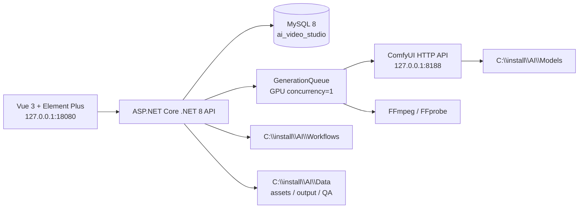
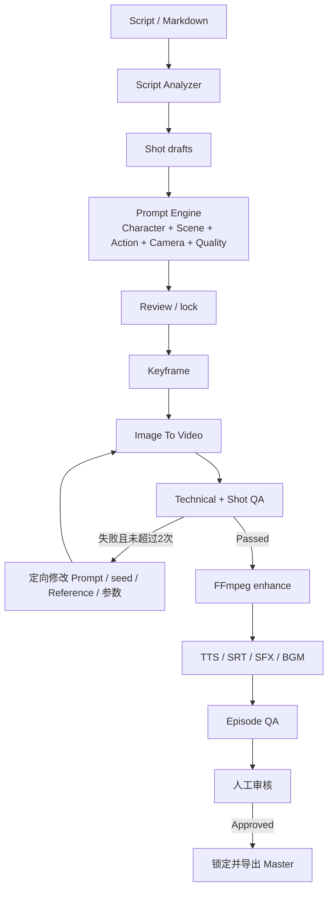

# AI Video Studio 实际架构

## 1. 系统边界

项目管理服务不是新的模型运行时。它调用已安装的 ComfyUI 和 FFmpeg，把生成式 AI 任务组织成可恢复的短剧生产链。服务默认只监听回环地址，不向局域网暴露管理页面。

## 2. 模块职责

### Web

`web` 是 Vue 3 + Element Plus 单页应用，生产构建输出到 `web/dist`，由 ASP.NET Core 静态文件中间件提供。当前工作台包含 Dashboard、项目/Episode、角色、场景、剧本、生产、任务、素材、质量 QA 和系统入口。修改 UI 后必须进行真实浏览器操作验证，编译通过不代表 UI 通过。

### Server

`server` 使用 .NET 8 Minimal API：

- `Program.cs`：启动、配置、静态文件、基础 API、数据库 schema 检查和服务注册。
- `ProductionEndpoints.cs`：剧本、Prompt、生产计划、音频、字幕和 Episode 合成相关接口。
- `QaEndpoints.cs`：技术检查、Shot/Episode QA、问题、审核、解锁和导出。
- `GenerationQueue`：单消费者任务调度、依赖检查、GPU 门禁、ComfyUI 轮询、FFmpeg/TTS、失败分类和恢复。
- 配置/服务类：MySQL、ComfyUI、工作流扫描、媒体路径安全、FFprobe 和操作日志。

### Database

MySQL 保存项目事实、任务状态、Prompt 版本、QA 结果、操作日志和媒体元数据。媒体文件和模型权重保存在磁盘；数据库只记录规范化后的路径、哈希、尺寸、时长和状态。详见 `DATABASE.md`。

### External runtimes

- ComfyUI：生成关键帧和 I2V，使用 HTTP `/prompt`、`/history`、`/view`、`/interrupt`。
- FFmpeg/FFprobe：解码检查、去闪烁/插帧/增强、拼接、字幕烧录、音频混音和 1080P/30 FPS 输出。
- Windows System.Speech：可选本地 TTS；TTS 不在线时不能伪造音频完成。

## 3. 生产状态流

任务状态、依赖和结果必须由真实 ComfyUI/FFmpeg/数据库证据推进。服务重启时遗留 `Running` 任务恢复到 `Pending`；依赖失败时下游不能被错误放行。

## 4. 4070 12GB 资源策略

- GPU 任务并发为 1，`MinFreeVramMiB=1024`；执行前查询 ComfyUI `/system_stats`。
- 人物关键帧使用 SD1.5 工作流，视频使用 LTX 2B FP8 工作流。源视频推荐 512×320、24 FPS、73/97/121 帧，分别接近 3/4/5 秒。
- 最终 1920×1080/30 FPS 通过 FFmpeg 完成。不要把 1080P 直接送入 LTX 2B。
- OOM 定向降低帧数、分辨率、候选数或 steps；任务保留错误分类、实际参数和 GPU 指标。
- 不把需要 24GB 以上显存的模型加入默认预设，不同时启动多个大模型。

## 5. 数据与路径安全

- 上传和生成媒体必须在 `C:\install\AI\Data` 下。
- 复制参考图到 ComfyUI `input` 前检查规范化路径；预览接口拒绝工作区外路径和路径穿越。
- 模型、工作流、备份、日志和媒体属于机器运行数据，均不提交 Git。
- MySQL 密码只从未跟踪的 `config\local.env` 读取。详细规则见根目录 `AGENTS.md`。
