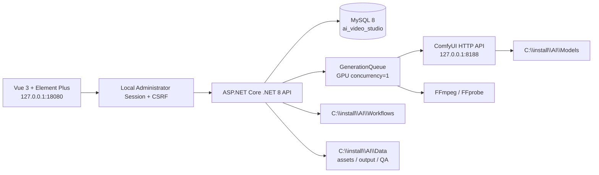
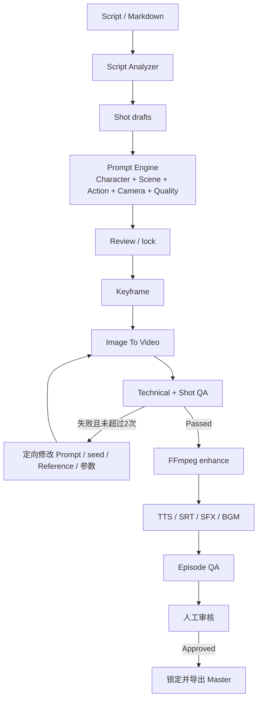

<!-- character-story-20261027:start -->
> 2026-10-27：Additive immutable cast/Shot snapshots reuse entity_versions and original Episode/Shot. Explicit story-keyframe review previews preserve formal H3/release gates. Local bounded GPU, restart recovery and preview technical checks Passed; final human content review pending. 详见[本轮验收](CHARACTER_STORY_ACCEPTANCE_20261027.md)。
<!-- character-story-20261027:end -->

<!-- character-reference-pack-20261026:start -->
> 人物库继续复用entity_versions，不增加数据库结构。character-library-v2在参考中新增framing，并保存referencePack、viewConvention及体型比例；视角只表示方向。v1按原始序列化/哈希读取，新字段为null时不输出，旧请求指纹与幂等回放保持。新版按(view, framing)精确选图，提交与执行复核冻结快照、源SHA和工作流；试用模式继续独立于正式Shot/Episode。九图为3近景＋6全身，8个方向与3个景别可扩展。详见[实现与验收](CHARACTER_REFERENCE_PACK_20261026.md)。
<!-- character-reference-pack-20261026:end -->

<!-- realistic-i2v-resume-20261022:start -->
> 2026-10-23: Controlled local prop layout plus masked SDXL harmonization preserves the unedited subject. H3 native1080 comparison varies only20/30steps; the selected actual last frame anchors continuation, then a single CPU export adds complete Qwen narration. Final1215 technical Passed, content NeedReview. Thirty-step jobs have480-minute deadlines; other native1080 routes retain360minutes. GPU concurrency remains one. See[report](REALISTIC_I2V_20261022.md).
<!-- realistic-i2v-resume-20261022:end -->

<!-- realistic-i2v-20261022:start -->
> History: The2026-10-22 reference blocker was resolved after explicit user continuation. Final1215 was delivered2026-10-23; the current delivery status above is authoritative.
<!-- realistic-i2v-20261022:end -->

# AI Video Studio 实际架构

<!-- seedvr2-20261022:start -->
> 独立预览新增VideoRestore：预检绑定引擎摘要/源SHA/强度/切点，经GPU全局锁、Comfy外部队列空闲检查、显存检查及离线Python子进程执行。3B FP8、BlockSwap与VAE分块；逐镜头PNG结果编码一次，随后单独无损混流并校验AAC。Concat.singlePass合并拼接/归一化/裁剪/混音；Concat.audioStreamCopyFrom提供绑定源SHA的同规格无损换轨。正式Episode审核路线保留。GET /api/video-restore/comparison只返回受控Artifacts媒体路径。详见[接口与证据](VIDEO_DETAIL_SEEDVR2_20261022.md)。
<!-- seedvr2-20261022:end -->

<!-- qwen3-video-20261022:start -->
> CPU Concat的audioTracks新增可选tempo，默认1，预检和执行均限制为0.5–2的有限数值。FFmpeg先用atempo保持音高调整语速，再按startSeconds和volume混入；原始TTS音频作为独立资产保留。正式剧集音轨继续通过EpisodeRender及原有审核路线。实际Qwen新视频样例与证据见[10秒配音短片](QWEN3_VIDEO_10S_20261022.md)。
<!-- qwen3-video-20261022:end -->

<!-- qwen3-tts-20261022:start -->
> Qwen3-TTS通过既有Audio正式任务及资产发布接入，voiceId使用qwen3:前缀区分引擎；其资源类别为GPU，与Comfy视频共用GpuGlobalGate。每任务启动独立离线Python子进程，完成/取消/超时后释放显存；Windows系统TTS保留CPU类别。配置与推理代码摘要绑定到任务，音频与推理记录分别发布；配音历史采用专用按时间排序接口。 详见[本地配音报告](QWEN3_TTS_LOCAL_20261022.md)。
<!-- qwen3-tts-20261022:end -->

## 2026-10-18 本地 MiniMax 与访问模式增量

MiniMax本地H3沿用既有GenerationQueue、ComfyUI和资产发布：固定模型/工作流/首帧哈希，实验视频与原生音轨分开登记，禁止自动升级为正式剧集。原有SD1.5/LTX/System.Speech保留。按用户要求开启仅回环LocalOnly免登录，写请求仍需签名CSRF并审计；详情和真实验证边界见[接入报告](MINIMAX_LOCAL_INTEGRATION_20261018.md)。

## 1. 系统边界

项目管理服务不是新的模型运行时。它调用已安装的 ComfyUI 和 FFmpeg，把生成式 AI 任务组织成可恢复的短剧生产链。服务默认只监听回环地址，不向局域网暴露管理页面。业务 API 默认拒绝匿名请求；首次本机初始化只写 PBKDF2-SHA512 验证值，管理员会话使用 HttpOnly/Strict Cookie，危险方法需通过 CSRF，登录与写请求记录到安全审计表。

## 2. 模块职责

### Web

`web` 是 Vue 3 + Element Plus 单页应用，生产构建输出到 `web/dist`，由 ASP.NET Core 静态文件中间件提供。当前工作台包含 Dashboard、项目/Episode、角色、场景、剧本、生产、任务、素材、质量 QA 和系统入口。修改 UI 后必须进行真实浏览器操作验证，编译通过不代表 UI 通过。

### Server

`server` 使用 .NET 8 Minimal API：

- `Program.cs`：启动、配置、静态文件、基础 API、数据库 schema 检查和服务注册。
- `ProductionEndpoints.cs`：剧本、Prompt、生产计划、音频、字幕和 Episode 合成相关接口。
- `QaEndpoints.cs`：技术检查、Shot/Episode QA、问题、审核、解锁和导出。
- `GenerationQueue`：单消费者任务调度、依赖检查、GPU 门禁、ComfyUI 轮询、FFmpeg/TTS、失败分类和恢复。
- 配置/服务类：MySQL、ComfyUI、工作流扫描、媒体路径安全、FFprobe 和操作日志。

### Database

MySQL 保存项目事实、任务状态、Prompt 版本、QA 结果、操作日志和媒体元数据。媒体文件和模型权重保存在磁盘；数据库只记录规范化后的路径、哈希、尺寸、时长和状态。详见 `DATABASE.md`。

### External runtimes

- ComfyUI：生成关键帧和 I2V，使用 HTTP `/prompt`、`/history`、`/view`、`/interrupt`。
- FFmpeg/FFprobe：解码检查、去闪烁/插帧/增强、拼接、字幕烧录、音频混音和 1080P/30 FPS 输出。
- Windows System.Speech：可选本地 TTS；TTS 不在线时不能伪造音频完成。

## 3. 生产状态流

任务状态、依赖和结果必须由真实 ComfyUI/FFmpeg/数据库证据推进。服务重启时遗留 `Running` 任务恢复到 `Pending`；依赖失败时下游不能被错误放行。

## 4. 4070 12GB 资源策略

- GPU 任务并发为 1，`MinFreeVramMiB=1024`；执行前查询 ComfyUI `/system_stats`。
- 人物关键帧使用 SD1.5 工作流；有人物参考的视频默认使用 LTX 2B FP8 v3 稳定 Draft，无人物参考仍使用 Wan2.2 TI2V-5B。人物 Draft 固定 320×416、24 FPS、73 帧起步；其他输入再按参考图比例使用 512×320 或 384×384，并根据抽帧验收提高帧数。
- 最终 1920×1080/30 FPS 通过 FFmpeg 完成。不要把 1080P 直接送入 LTX 2B。
- OOM 定向降低帧数、分辨率、候选数或 steps；任务保留错误分类、实际参数和 GPU 指标。
- 不把需要 24GB 以上显存的模型加入默认预设，不同时启动多个大模型。

## 5. 数据与路径安全

- 上传和生成媒体必须在 `C:\install\AI\Data` 下。
- 复制参考图到 ComfyUI `input` 前检查规范化路径；预览接口拒绝工作区外路径和路径穿越。
- 模型、工作流、备份、日志和媒体属于机器运行数据，均不提交 Git。
- MySQL 密码只从未跟踪的 `config\local.env` 读取。详细规则见根目录 `AGENTS.md`。

## Character library pilot (2026-10-26)

`CharacterLibraryService` stores append-only `character-library-v1` payloads in the existing `entity_versions` table. Each version freezes a character identity prompt, outfit, voice settings, explicitly selected reference views and their hashes, and one pinned local video workflow. No model weights or media are stored in MySQL.

The dedicated `/api/character-library/resolve` endpoint previews the concrete input without enqueueing. `/generate` builds an experimental H3 task and uses the existing preflight, idempotency and generation queue. Both submission and queue execution validate the library snapshot, reference bytes and workflow hash; the copied Comfy first frame is hashed again. Shot/Episode binding and production-mode overrides are rejected by this pilot. Existing manual/production release gates remain authoritative.

A character draft edit does not mutate a library version. Source character deletion and version capture share a row lock so that their race cannot orphan source references. See `docs/CHARACTER_LIBRARY_20261026.md` for actual acceptance evidence and the intentionally limited motion/view scope.
