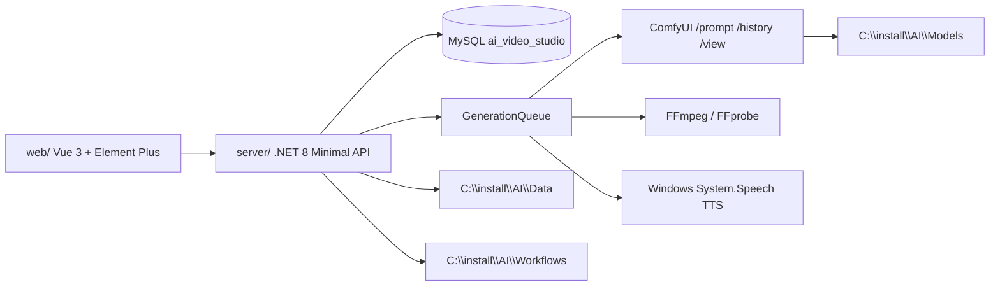

# AI Video Studio 生产化 v1：阶段 0 本机证据基线

> 核验日期：2026-08-13（Asia/Shanghai）\
> 项目根目录：`C:\install\AI\VideoStudio`\
> 本文件只记录本轮已经执行的只读核查和可从本机复现的事实，不把历史快照或计划写成当前通过。

## 1. 执行边界

- 已完整读取执行包四份 Markdown，并按 UTF-8 解码。
- 已读取项目 `AGENTS.md`、根目录中文档案、`PROJECT_STATE.md`、`NEXT_STAGE.md`、`CHANGELOG.md`、`docs` 中的架构、数据库、开发、验收和历史生产记录。
- 本阶段只读检查 Git、源代码、数据库元数据/聚合数据、服务端口、外部运行目录、工具版本和测试入口。
- 未启动 API/ComfyUI，未运行正式迁移，未启动真实 GPU 任务，未安装/升级依赖，未删除/移动/覆盖媒体，未 Commit/Push。

## 2. Git 与用户工作区保护

| 项目 | 证据 |
|---|---|
| 分支 | `main` |
| 起始 HEAD | `d6ec38d076a8b0336d349c36df5c123f2c941ac8` (`docs: initialize Chinese project management archive`) |
| Remote | 存在 `origin`，本轮未访问、未推送 |
| 起始工作区 | 32 个已跟踪文件有修改，41 个未跟踪路径；涉及 `server`、`web`、迁移、脚本和项目档案 |
| 保护措施 | 未执行 `git reset`、`git clean`、checkout、回滚、覆盖、Commit 或 Push；不改动已有用户代码文件 |
| 当前变更策略 | 阶段 0 基线文档与验收/回传附件已更新；随后仅做了逐文件核对后的最小可回滚安全修正和只读静态回归，未执行数据/服务/GPU操作 |

已跟踪的用户修改包含 `server/Database.cs`、`GenerationQueue.cs`、`Program.cs`、`ProductionEndpoints.cs`、`AssetPathPolicy.cs` 相关调用方以及 `web/src/App.vue` 等，故不能将这些文件视为本轮干净基线。

## 3. 本机运行时与服务状态

| 项目 | 本轮证据 |
|---|---|
| .NET SDK | `10.0.103`；项目目标框架为 `net8.0` |
| Node/npm | `v20.18.1` / `10.8.2` |
| GPU | `NVIDIA GeForce RTX 4070`，总显存 `12282 MiB`，空闲 `11059 MiB`，驱动 `591.86` |
| MySQL | TCP `127.0.0.1:3306` 可连；数据库服务版本 `8.0.22` |
| FFmpeg/FFprobe | `C:\install\FFmpeg\bin\ffmpeg.exe` 与 `ffprobe.exe`，版本 `9.0-essentials_build` |
| API | `127.0.0.1:18080` 当前未监听；`GET /api/health` 本轮无法连接 |
| ComfyUI | `127.0.0.1:8188` 当前未监听；`GET /system_stats` 本轮无法连接 |
| Vite | `127.0.0.1:18081` 当前未监听 |
| 当前任务 | MySQL 聚合查询：`Succeeded=889`、`Failed=20`、`Cancelled=55`；`Pending/Running=0` |

API/ComfyUI 未启动不是本轮代码失败，而是阶段 0 的当前环境事实；当前 `DatabaseInitializer.TryInitializeAsync` 已增加 `AI_VIDEO_STUDIO_AUTO_APPLY_SCHEMA` 显式开关且默认关闭，未确认前仍不启动应用，也不启用正式 schema 变更。

## 4. 真实模块图与生产链

真实代码映射：

- 启动、认证、CORS、静态页面和基础 API：`server/Program.cs`。
- MySQL 连接、Repository、任务和 schema 初始化：`server/Database.cs`。
- 队列、依赖、租约、GPU 门禁、ComfyUI 轮询、FFmpeg/TTS/QA：`server/GenerationQueue.cs`。
- ComfyUI HTTP：`server/ComfyUiClient.cs`；媒体处理：`server/FfmpegService.cs`；TTS/SRT：`server/MediaProductionServices.cs`。
- 剧本/Prompt/生产计划/音频/Episode：`server/ProductionEndpoints.cs`；QA/人工审核/导出：`server/QaEndpoints.cs`、`server/VideoQaServices.cs`。
- 前端入口：`web/src/App.vue`；浏览器用例：`web/tests/`。

生产链在当前代码中可映射为：

`Project → Episode → Shot/角色/场景 → Prompt/关键帧 → ImageToVideo → Enhance → Shot QA/人工审核 → TTS/SRT/BGM/SFX → EpisodeRender → Episode QA → QAExport/Master`。

本轮只证明代码和历史记录中存在这些入口；由于 API/ComfyUI 未启动，真实服务链本轮为 `NOT RUN`。

## 5. 数据库真实摘要

只读 MySQL 查询得到：

- 当前数据库为 `ai_video_studio`，共 39 张表；包括 `projects`、`episodes`、`shots`、`assets`、`generation_tasks`、`generation_results`、`task_events`、`qa_*`、`admin_sessions`、`security_audit_events` 等。
- 记录聚合：7 个项目、19 个 Episode、148 个 Shot、13 个角色、23 个场景、724 个资产、964 个任务。
- `generation_tasks` 终态聚合：889 个 `Succeeded`、20 个 `Failed`、55 个 `Cancelled`；当前无 `Pending`/`Running`。
- `schema_migrations` 已有 `002_production_pipeline`、`003_video_qa`、`004_reliability_references_audio`、`005_quality_optimization`、`007_local_auth_audit`；`006_repair_garbled_text.sql` 是数据修复脚本，本轮未运行且未计入已应用迁移。
- 运行连接用户为 `root@%`，全局授予包含 `CREATE`、`DROP`、`ALTER`、`CREATE USER`、`GRANT OPTION` 等权限；这不满足最小权限验收，且本轮不修改。

任务表已经有 `request_id`、唯一 `idempotency_key`、`input_fingerprint`、`state_version`、`lease_owner`、`lease_expires_at`、`heartbeat_at`、`deadline_at`、`cancel_requested_at` 和 `timed_out_at` 字段；但没有本轮竞态执行证据。

## 6. 当前状态机还原

| 当前状态/动作 | 代码证据 | 阶段 0 判断 |
|---|---|---|
| `Pending → Running` | `StudioRepository.ClaimTaskAsync`：条件 `status='Pending' AND paused=0` 更新租约、worker、attempt 和版本 | 已实现；双 worker 未验证 |
| `Running → Succeeded` | `GenerationQueue.ProcessAsync` 调用 `CompleteTaskAsync`，条件包含 worker/租约 | 已实现；真实产物 exactly-once 未验证 |
| `Running → Pending` | `RequeueTaskAsync`；异常且未超过 `maxRetries` 时重新排队 | 已实现；竞态未验证 |
| `Running → Failed` | `CompleteTaskAsync`/`MarkTaskTimedOutAsync`；错误分类和最大重试路径存在 | 已实现；迟到消息矩阵未验证 |
| `Pending/Running → Cancelled` | `CancelTaskAsync` 条件更新，并尝试中断 ComfyUI | 已实现；取消/完成竞态未验证 |
| 过期恢复 | `RecoverRunningTasksAsync` 使用数据库 `NOW(3)` 将过期 Running 改为 Pending | 已实现；服务重启本轮未启动 |
| 依赖阻断 | `TaskDependencyStateAsync` 对 Failed/Cancelled 上游调用 `FailPendingTaskAsync` | 已实现；循环依赖/并发未验证 |
| 非法迁移风险 | `MarkTaskRunningAsync`、`MarkTaskAsync` 仍是无 worker/状态机白名单的旧式 Repository 方法，当前 `rg` 未发现调用方 | 遗留风险，需单元/集成测试或移除前先核对用户修改 |
| GPU并发 | 进程内 CPU/GPU Channel 各单 reader，`WaitForGpuAsync` 做显存门禁 | 单进程约束存在；跨进程锁不存在/未证明 |

另一个重要差异是租约更新使用应用侧 `DateTime.UtcNow`，过期查询使用 MySQL `NOW(3)`；本轮未做时区/时钟偏差测试，不能将租约恢复标为完全通过。

## 7. 资产、路径与外部进程边界

已有 `server/AssetPathPolicy.cs`，具备 Data/Models 根目录、绝对/相对路径规范化、UNC/设备路径拒绝、重解析点检查、扩展名/MIME/FFprobe 上传校验、临时 `.part` 文件和 SHA-256。

仍可由静态代码核查确认的缺口：

- `Program.cs`、`ProductionEndpoints.cs`、`QaEndpoints.cs`、`GenerationQueue.cs` 仍存在直接 `File.Exists`/原始路径处理；Episode 音频路径和 QA 输入未全部经统一策略/资产归属校验。
- API 仍以 `assetPath` 查询参数和多处路径字段为主，并非全链路 `assetId`/下载令牌；`TryResolveExisting` 主要验证“Data 根内、存在、无重解析点”，未统一验证用途扩展名、项目归属和引用状态。
- `FfmpegService` 主要使用参数数组，未做完整注入负向测试；ComfyUI 工作流和参数映射代码存在，但正式任务的受控注册/攻击面未做矩阵测试。
- 资产版本、Manifest、保留/软删除、原子发布后的数据库-文件对账和恢复演练尚未形成证据。

## 8. 认证、权限、CORS 与出站

- `Program.cs` 固定 `UseUrls("http://127.0.0.1:18080")`；CORS 允许四个本机来源并启用凭据。
- `LocalAuthService` 实现单一 `Administrator`、PBKDF2-SHA512、HttpOnly/SameSite 会话、CSRF、登录限流、Origin/回环检查和安全审计。
- 本机管理员隔离回归和 Playwright 6/6 是历史代码证据；本轮 API 未运行，故本轮不重复标成新鲜运行通过。
- 当前不是多用户 RBAC、TLS 或 LAN/公网安全方案；网络开放仍 No-Go。
- `ScriptAndPromptServices.cs` 可从数据库读取 `llm.base_url`、`llm.api_key`，直接构造出站 URL；当前未见 allowlist、重定向控制、预算/响应大小闸门和出站预览。本轮未向任何第三方发送内容。

## 9. 外部资产与工具盘点

- `C:\install\AI\Workflows` 当前有 15 个 JSON 工作流文件；外部模型目录存在 8 个模型类文件，`Models/loras` 未发现已登记 LoRA 文件证据。
- `C:\install\AI\ComfyUI`、`C:\install\AI\Models`、`C:\install\AI\Data` 和 `C:\install\FFmpeg` 均存在；本轮不移动、不复制、不安装、不删除其中内容。
- 当前项目源码登记/历史文档中的工作流数量与外部目录数量不完全一致；应以运行时扫描后的 DB 和服务健康响应为准，API/ComfyUI 未启动，本轮标记待验证。

## 10. 阶段 0 差距矩阵

| 领域 | 已具备 | 部分具备 | 缺失/风险 | 本轮证据状态 |
|---|---|---|---|---|
| 工作区保护 | Git 基线、状态、分支、远程可读 | 用户改动范围很大 | 无法安全覆盖同名源文件 | PASS（保护已执行） |
| 生产链 | Project/Episode/Shot、任务、QA、Episode 输出入口 | 音频闭环、真实样片 | 真实 API/ComfyUI 当前离线 | NOT RUN |
| 任务可靠性 | DB 字段、唯一键、条件领取、租约/心跳代码 | 重试/恢复代码 | 跨 worker、旧租约、Exactly-once、GPU跨进程锁 | NOT RUN |
| 资产路径 | AssetPathPolicy、上传校验、重解析点检查 | 部分调用方已迁移 | 原始路径/用途/归属/Manifest/原子发布不统一 | FAIL/NOT RUN |
| 数据库 | 迁移文件和 `schema_migrations`、真实表结构 | 添加式兼容 migrator；schema 自动变更现已显式 opt-in | root 全权、恢复未演练、opt-in 后的正式迁移仍未运行 | FAIL/NOT RUN |
| 认证 | 单管理员会话、CSRF、精确本机来源、审计代码 | 历史隔离回归 | 多用户 RBAC/TLS/LAN 未做 | PASS（历史）/本轮 NOT RUN |
| LLM出站 | 本地 RuleBased 回退 | 可配置适配器 | URL allowlist、脱敏/预览、重定向和预算 | FAIL/NOT RUN |
| 媒体 QA | FFprobe/FFmpeg、QA 夹具、人工审核 API | 历史 3-shot 证据 | 当前服务离线，音频/恢复未重跑 | NOT RUN |
| 人物工艺 | 工作流/预设/IP-Adapter/ControlNet 入口 | 3 秒 draft 和静态矩阵 | 5 秒复杂动作、LoRA、用户人工视觉验收 | NOT RUN |

## 11. 本次最小实施包（阶段 0 输出）

在用户确认高风险门槛前，允许的最小范围是：

1. 新增不触碰既有业务代码的路径/状态机纯测试或静态回归脚本；优先验证现有 `AssetPathPolicy` 和任务状态规则，避免引入新依赖。
2. 新增生产化文档、工艺注册表、SOP 和报告索引；不把设计文档写成真实运行通过。
3. 对现有代码做小步、可回滚的安全修复前，先以当前用户未提交版本为基线，逐文件确认差异；本轮已在 `AssetPathPolicy.cs`、`Database.cs` 和 `ScriptAndPromptServices.cs` 完成最小修正，并保留未相关文件不动。
4. 正式迁移、API 启动、真实 GPU、依赖安装、媒体删除/覆盖、网络开放、Commit/Push 均不在本阶段自动执行。

## 12. 阶段 0 结论

阶段 0 已形成可核查的代码、表、索引、命令和运行环境证据；不存在“生产任务正在运行”的阻塞。当前真正的实施阻塞是：API/ComfyUI 未启动；工作区存在用户既有修改且代码改动高度重叠；root 高权限、正式数据库迁移/恢复、跨 worker/GPU 锁、真实 GPU 和安装类操作仍需用户确认。schema 自动变更现已默认关闭，但启用该开关仍属于正式数据库变更。

因此下一步可以继续做不触碰现有业务数据、无需启动服务、无需新增依赖的安全可逆测试与文档；不能把本轮升级为真实生产验收或完整 GO。

## 13. 阶段 0 后增量修正（2026-08-13）

- `AssetPathPolicy.HasReparsePointInPath` 现只检查存在目录的属性，同时继续检查存在的祖先目录；首个 `Temp/Uploads` 上传不再因不存在目录属性 `-1` 被误判。
- `DatabaseInitializer` 现受 `AI_VIDEO_STUDIO_AUTO_APPLY_SCHEMA` 保护，默认 `0`；本轮未执行建库、建表或迁移。
- `ScriptAndPromptServices.cs` 的 `ContentLength is > maxBytes` 编译模式改为显式 `long` 比较；完整后端重新构建 0 warnings/0 errors。
- 静态回归 13/13、前端构建和 `git diff --check` 通过；API/ComfyUI、真实 GPU、数据库写入、浏览器 E2E、备份恢复和人工验收仍未运行。
