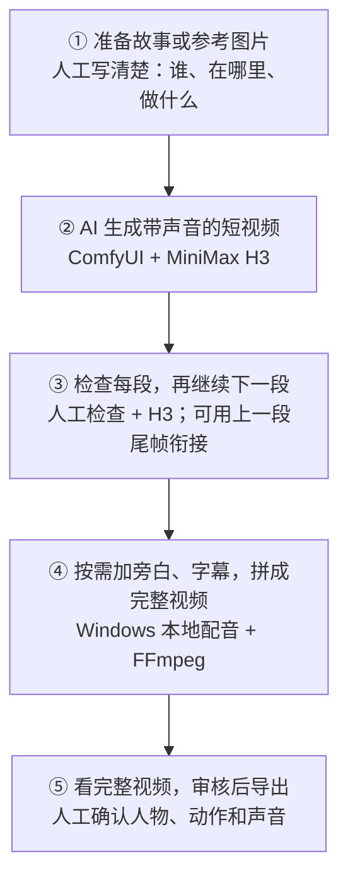

<!-- character-scene-20261027:start -->
## 同机位场景连续性（2026-10-27）

复用现有Scene资产，冻结已检查构图的来源任务、SHA256、两位演员造型、站位、机位和区域。现有Klein使用四个人物输入加一个构图输入，生成的双人区域羽化合成回原背景；区域外像素保持已有实证，区域内脸、手、方向仍需逐图检查。此方式限定同机位双人中景，切镜、换演员或造型要建立新基准。

合格静态关键帧才可交给H3首帧路线，Ref2VA未启用。当前三张内容失败、人物来源被拒绝，且用户明确保持待审，所以没有新H3或合成结果。控制器保存幂等请求与审核暂停，不能靠改seed、换版本或重启绕过。[实施与边界](CHARACTER_SCENE_CONTINUITY_20261027.md)。
<!-- character-scene-20261027:end -->

<!-- character-story-20261027:start -->
> 2026-10-27：RealVisXL候选→人工身份→Klein造型与九图→审核冻结→项目/集选角→Shot剧情关键帧→检查→H3首帧视频→定向修复→FFmpeg送审。Comfy执行模型，业务保存任务/审核/版本。双人须检查静态，H3 Ref2VA未启用，声音策略明确。 详见[本轮验收](CHARACTER_STORY_ACCEPTANCE_20261027.md)。
<!-- character-story-20261027:end -->

# 用 MiniMax H3 制作有声视频（简版）

**把故事或参考图片交给 AI，生成带声音的短视频，再把各段拼成完整短片。**

## 工作流程图

## 这些工具分别做什么

| 工具 | 简单理解 |
| --- | --- |
| **ComfyUI** | 把输入、AI 生成和保存结果这些步骤串起来执行 |
| **MiniMax H3** | 根据文字或图片，生成视频画面和原生声音 |
| **Windows 本地配音** | 需要额外旁白时，把文字读成声音 |
| **FFmpeg** | 把多段视频拼接，加上字幕，混合旁白和背景音乐 |

比如“女孩发现笔记本并归还给男生”，可以拆成“发现 → 拿起 → 归还”几个短镜头，逐段生成、检查，再拼在一起。

H3 已在本项目中实际运行；目前属于本地实验路线。人物有没有变样、动作是否正确、声音是否合适，仍要人工检查。
